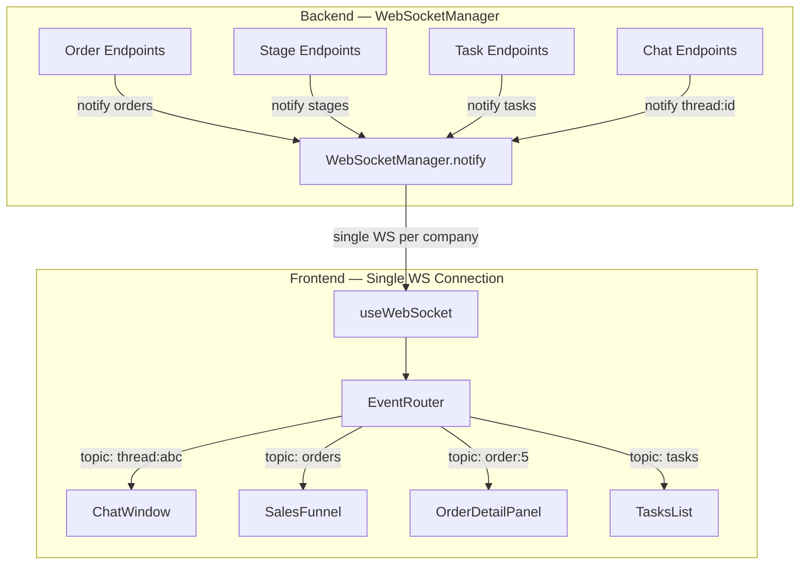

# 038 — Topic-Based Real-Time WebSocket Architecture

## Objective

Extend the existing single-WS-per-company design with **topic-based subscriptions** so any entity (orders, stages, tasks, billing, …) can push real-time updates to the frontend with minimal per-feature wiring. First concrete use-case: live Kanban board (orders + stages).

## Зачем это делаем

- **Проблема**: Сейчас в реальном времени работает только чат. Воронка, заказы, задачи, стадии — всё обновляется только по ручному рефрешу или refetch. Менеджер открыл воронку — и не видит, что коллега только что перетащил заказ или AI сменил стадию.
- **Ценность для продукта**: Живой, отзывчивый интерфейс без кнопки "обновить". Любое изменение по любой сущности мгновенно отражается у всех пользователей компании. Это фундамент для кооперативной работы.
- **Что становится возможным**: Добавление real-time обновлений для новых сущностей становится тривиальным — 1 строка на бэкенде (`ws_manager.notify(...)`) + 1 хук на фронте (`useRealtimeRefresh(topic, refetch)`). Горизонтальное масштабирование бэкенда — через замену одного метода на Redis Pub/Sub без изменений протокола и фронтенда.

---

## Design Decisions

### Approach: Single Connection + Topic Subscriptions

**Rejected:**

| Alternative | Why rejected |
|---|---|
| WS per entity type | Multiplies connections, auth flows, reconnect logic. Browser WS limits. |
| WS per page | Same problems + awkward when page needs events from multiple entities. |
| SSE | Unidirectional, no subscribe/unsubscribe. Separate endpoints per entity. |

**Chosen:** Extend existing WS with topic-based pub/sub — industry standard (Slack, Linear, Phoenix Channels). Natural evolution of current `subscribe`/`unsubscribe` thread pattern.

### Protocol

**Topics** — hierarchical string identifiers:

| Topic | Scope | Auto-subscribed | Example events |
|---|---|---|---|
| `company` | All connections | Yes (on connect) | `thread_created`, `thread_list_update` |
| `thread:<id>` | Thread subscribers | No (explicit) | `message`, `note`, `control`, `thread_updated` |
| `orders` | Company-wide | No (explicit) | `order_created`, `order_updated`, `order_closed` |
| `order:<id>` | Single order | No (explicit) | `order_updated`, `order_field_changed` |
| `stages` | Company-wide | No (explicit) | `stage_created`, `stage_updated`, `stage_deleted` |
| `tasks` | Company-wide | No (explicit) | `task_created`, `task_updated`, `task_completed` |

**Client messages (extended):**

```json
{ "type": "subscribe", "topic": "orders" }
{ "type": "unsubscribe", "topic": "orders" }
```

Legacy format `{ "type": "subscribe", "thread_id": "abc" }` maps to `topic: "thread:abc"` internally.

**Server events (extended):**

```json
{
  "event_id": "uuid",
  "topic": "orders",
  "event_type": "order_updated",
  "thread_id": null,
  "payload": { "order_id": 5, "changes": ["stage_id"] },
  "emitted_at": "2026-03-15T16:00:00Z"
}
```

### Horizontal Scaling (future)

Single-process in-memory WS manager works now. When multiple instances needed:
- Swap `InMemoryBroadcastBackend` for `RedisBroadcastBackend` — one config change
- Each instance subscribes to Redis Pub/Sub channels; forwards to local connections
- **Zero protocol/frontend changes**

### Abstract Broadcast Backend (FastAPI Depends chain)

The broadcast layer is behind a simple `Protocol` — swappable via FastAPI's dependency mechanism, same pattern the project already uses for `RedisKVClient`, `ChatService`, etc.

```python
class BroadcastBackend(Protocol):
    async def publish(self, channel: str, event: RealtimeEvent) -> None: ...
    async def subscribe(self, channel: str, callback: Callable[[RealtimeEvent], Awaitable[None]]) -> None: ...
    async def unsubscribe(self, channel: str) -> None: ...
```

**Wiring via Depends + `@lru_cache`:**

```python
# services/realtime/broadcast.py

@lru_cache
def get_broadcast_backend() -> BroadcastBackend:
    return InMemoryBroadcastBackend()

BroadcastBackendDep = Annotated[BroadcastBackend, Depends(get_broadcast_backend)]
```

To swap to Redis later — just change the factory body:

```python
@lru_cache
def get_broadcast_backend() -> BroadcastBackend:
    from backend.services.redis import get_redis_client
    return RedisBroadcastBackend(get_redis_client())
```

**WebSocketManager chains it:**

```python
# websocket.py
@lru_cache
def get_websocket_manager(backend: BroadcastBackendDep) -> WebSocketManager:
    return WebSocketManager(backend)

WebSocketManagerDep = Annotated[WebSocketManager, Depends(get_websocket_manager)]
```

**Implementations:**

- `InMemoryBroadcastBackend` — direct dispatch, no serialization. `publish()` calls registered callbacks directly. Ships first.
- `RedisBroadcastBackend` (future) — takes `RedisKVClient` in constructor. `PUBLISH`/`SUBSCRIBE` on `ws:{channel}`. Swap by changing one `@lru_cache` factory.

`WebSocketManager` owns local connection tracking (which WS is subscribed to which topic). The broadcast backend only handles cross-instance fan-out. For in-memory, `publish` just calls the callback directly — zero overhead.

---

## Phase 1 — Backend: Generalize WebSocketManager + Broadcast Abstraction

**Module:** `apps/backend`

**Modifies:**

- `src/backend/modules/chat/websocket.py` — core WS manager
- `src/backend/modules/chat/schemas.py` — `RealtimeEvent` model
- `src/backend/modules/chat/routers.py` — WS route handler

**Creates:**

- `src/backend/services/realtime/__init__.py`
- `src/backend/services/realtime/broadcast.py` — `BroadcastBackend` protocol, `InMemoryBroadcastBackend`, `get_broadcast_backend` / `set_broadcast_backend`, `BroadcastBackendDep`

**Changes:**

1. **`broadcast.py`** — Broadcast abstraction + dependency:
   ```python
   class BroadcastBackend(Protocol):
       async def publish(self, channel: str, event: RealtimeEvent) -> None: ...
       async def subscribe(self, channel: str, callback: Callable) -> None: ...
       async def unsubscribe(self, channel: str) -> None: ...

   class InMemoryBroadcastBackend:
       """Direct local dispatch. No serialization, no network."""
       # subscribe() stores callback in dict[str, list[Callable]]
       # publish() calls all callbacks for that channel directly
       # Equivalent to current behavior — zero overhead

   @lru_cache
   def get_broadcast_backend() -> BroadcastBackend:
       return InMemoryBroadcastBackend()

   BroadcastBackendDep = Annotated[BroadcastBackend, Depends(get_broadcast_backend)]
   ```

2. **`websocket.py`** — Refactor `WebSocketManager`:
   - Accept `BroadcastBackend` in constructor
   - Replace `thread_subscriptions: dict[str, set[WebSocket]]` with `topic_subscriptions: dict[str, set[WebSocket]]`
   - `ConnectionMeta.thread_ids` → `ConnectionMeta.topics: set[str]`
   - New methods: `subscribe_topic()`, `unsubscribe_topic()`, `broadcast_to_topic()`
   - New generic entry point: `notify(company_id, topic, event_type, payload)` — builds `RealtimeEvent`, publishes via `broadcast_backend.publish()` for cross-instance, then delivers to local topic subscribers
   - Existing `subscribe_thread()` / `unsubscribe_thread()` / `broadcast_to_thread()` become thin wrappers delegating to `subscribe_topic("thread:<id>")` etc.
   - Existing `notify_message()`, `notify_thread_created()`, etc. become thin wrappers calling `notify()` with appropriate topic

3. **`schemas.py`** — Extend `RealtimeEvent`:
   - Add `topic: str` field (required)
   - Relax `event_type` from enum to `str` for extensibility
   - Keep `thread_id: str | None = None` for backward compat

4. **`routers.py`** — WS route handler `receive_json` loop:
   - Accept `topic` field in subscribe/unsubscribe messages
   - Fallback to `f"thread:{thread_id}"` when `topic` absent (backward compat)

**Future Redis swap** — when needed, create `RedisBroadcastBackend` implementing the same protocol and pass it to `WebSocketManager(backend=RedisBroadcastBackend(redis))`. Nothing else changes.

**Dependencies:** None — this phase is self-contained. All existing callers continue to work via shim methods.

---

## Phase 2 — Frontend: Topic Subscription Hooks

**Module:** `sales-front`

**Modifies:**

- `hooks/useWebSocket.ts` — add topic subscribe/unsubscribe + event routing
- `contexts/WebSocketContext.tsx` — expose `subscribeTopic` / `unsubscribeTopic`

**Creates:**

- `hooks/useRealtimeEvent.ts` — generic `useRealtimeEvent(topic, handler)` hook
- `hooks/useRealtimeRefresh.ts` — convenience `useRealtimeRefresh(topic, refetch)` with debounce

**Changes:**

1. **`useWebSocket.ts`**:
   - Add `subscribeTopic(topic)` / `unsubscribeTopic(topic)` — sends `{ type: "subscribe", topic }` over WS
   - Add `topicHandlers: Map<string, Set<(event) => void>>` — component-level event subscriptions
   - In `handleEvent`: route by `event.topic` to registered handlers (in addition to existing chat dispatch)
   - `subscribeThread(id)` / `unsubscribeThread(id)` become aliases for `subscribeTopic("thread:<id>")`

2. **`WebSocketContext.tsx`**: Expose `subscribeTopic`, `unsubscribeTopic`, `addTopicHandler`, `removeTopicHandler` in context value

3. **`useRealtimeEvent.ts`**:
   ```typescript
   function useRealtimeEvent(topic: string, handler: (event: RealtimeEvent) => void): void
   ```
   On mount: `subscribeTopic(topic)` + register handler. On unmount: `unsubscribeTopic(topic)` + unregister. Ref-stable handler via `useRef`.

4. **`useRealtimeRefresh.ts`**:
   ```typescript
   function useRealtimeRefresh(topic: string, refetch: () => void, debounceMs?: number): void
   ```
   Wraps `useRealtimeEvent` with debounced `refetch` (default 300ms) to coalesce burst events.

**Dependencies on Phase 1:** Backend must accept `{ type: "subscribe", topic: "..." }` messages and send events with `topic` field.

---

## Phase 3 — Wire Orders + Stages (Backend)

**Module:** `apps/backend`

**Modifies:**

- `src/backend/modules/orders/routers.py` — emit order events
- `src/backend/modules/orders/repository.py` — emit from encapsulated methods (update_assignee, update_stage)
- `src/backend/modules/stages/routers.py` (or equivalent) — emit stage events

**Changes:**

Add `ws_manager.notify(...)` calls after each mutation:

| Endpoint / Method | Topic | Event type |
|---|---|---|
| `OrdersRepository.update_assignee()` | `orders` + `order:<id>` | `order_updated` |
| `OrdersRepository.update_stage()` | `orders` + `order:<id>` | `order_updated` |
| `POST /orders` (create) | `orders` | `order_created` |
| `PATCH /orders/{id}` (update) | `orders` + `order:<id>` | `order_updated` |
| `PATCH /orders/{id}/fields` | `order:<id>` | `order_field_changed` |
| `PATCH /orders/{id}/extra-fields` | `order:<id>` | `order_field_changed` |
| `POST /orders/{id}/close` | `orders` + `order:<id>` | `order_closed` |
| `POST /stages` | `stages` | `stage_created` |
| `PATCH /stages/{id}` | `stages` | `stage_updated` |
| `DELETE /stages/{id}` | `stages` | `stage_deleted` |
| `POST /stages/reorder` | `stages` | `stage_reordered` |

Payload pattern: `{"order_id": id, "changes": ["field_name", ...]}` for orders; `{"stage_id": id}` for stages.

**Dependencies on Phase 1:** `ws_manager.notify()` method must exist.

---

## Phase 4 — Wire Orders + Stages (Frontend)

**Module:** `sales-front`

**Modifies:**

- `components/SalesFunnel.tsx` — subscribe to `orders` + `stages` topics
- `components/OrderDetailPanel.tsx` — subscribe to `order:<id>` topic

**Changes:**

1. **`SalesFunnel.tsx`**:
   ```typescript
   useRealtimeRefresh('orders', refetch);
   useRealtimeRefresh('stages', refetchStages);
   ```
   Kanban board auto-updates when any order/stage changes company-wide.

2. **`OrderDetailPanel.tsx`**:
   ```typescript
   useRealtimeEvent(`order:${orderId}`, () => {
     fetchOrder({ background: true });
   });
   ```
   Open order panel auto-refreshes when that specific order changes.

**Dependencies on Phase 2:** `useRealtimeRefresh` and `useRealtimeEvent` hooks. **Dependencies on Phase 3:** Backend emits order/stage events.

---

## Phase 5 (Future) — Tasks, Billing, Redis Pub/Sub

Not in current scope. Pattern is identical to Phase 3+4 for each new entity:

- **Backend**: `ws_manager.notify(company_id, "tasks", "task_created", {...})`
- **Frontend**: `useRealtimeRefresh("tasks", refetchTasks)`

Redis Pub/Sub: change `WebSocketManager.notify()` to publish to Redis channel alongside local broadcast. Each instance subscribes and forwards. Zero protocol/frontend changes.

---

## Architecture Diagram



---

## Рекомендуемая модель для выполнения

**Claude Opus 4.6** — задача затрагивает 2 модуля (backend + frontend), требует аккуратного рефакторинга существующего WebSocket менеджера с сохранением обратной совместимости, и включает архитектурные решения по протоколу. При этом план достаточно детальный — Sonnet справится с отдельными фазами, но для сквозного выполнения (Phase 1-4) с гарантией, что ничего не сломается в чат-реалтайме, Opus надёжнее.

Альтернативный вариант: **Sonnet по фазам** — Phase 1 отдельно, затем Phase 2 отдельно, с ручной проверкой чата между фазами.
